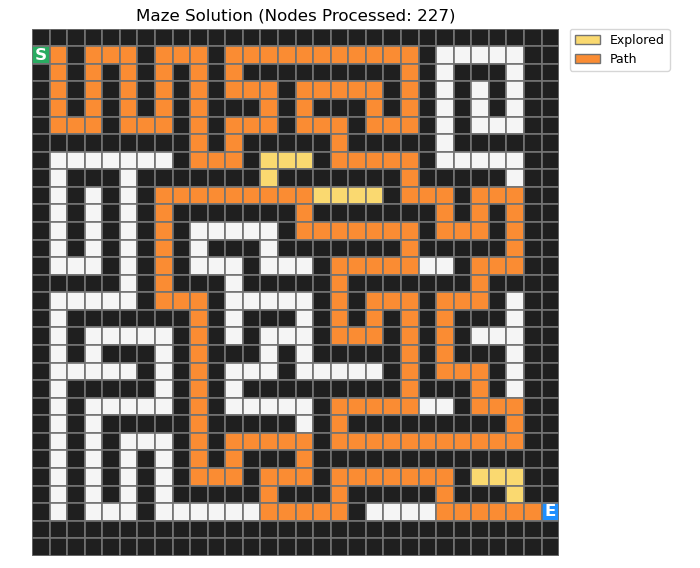
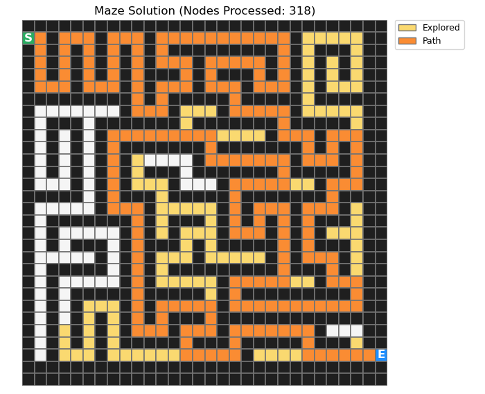

# Maze Search Visualizer

A small Python project that visualizes how depth-first search and breadth-first search traverse a maze and find a path from a start cell to an exit.

## Overview

This project renders the maze as a grid and highlights each algorithm's exploration process:

- yellow = nodes explored by the search
- orange = final path to the goal
- green = start position
- blue = end position
- dark cells = walls

## Algorithms included

- Depth-first search (DFS)
- Breadth-first search (BFS)

## Requirements

Install the dependency:

```bash
pip install matplotlib
```

## Run the project

From the repository root:

```bash
python3 maze_search_visualizer.py
```

Running the script will display the maze visualizations for both search strategies.

To switch which algorithm is shown, uncomment the desired call near the bottom of `maze.py`:

```python
# find_way(maze, start, end, depth_first_search)
find_way(maze, start, end, breadth_first_search)
```

## Legend

- `0` = open space
- `1` = wall
- `*` = final path

## Example outputs

### Depth-first search



### Breadth-first search


